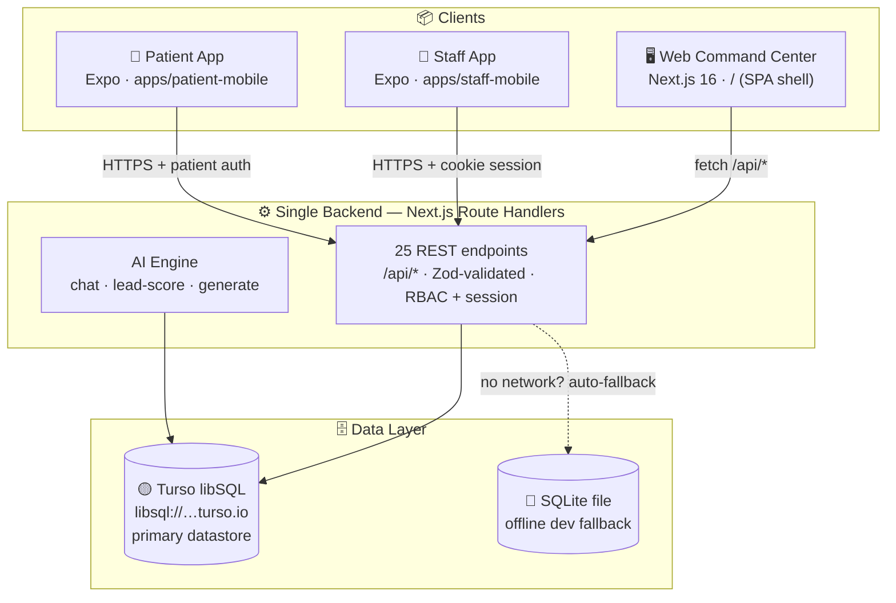

<div align="center">


# ✦ A U R A L I S

### **The All-in-One Operating System for Medical Spas — USA 🇺🇸 + UK 🇬🇧**

**One platform. Three apps. Zero fragmented stacks.**

Web Command Center · Staff Mobile App · Patient Mobile App — powered by a single multi-tenant backend on **Turso (libSQL)**.

[](https://nextjs.org)
[](https://typescriptlang.org)
[](https://turso.tech)
[](https://prisma.io)
[](https://expo.dev)
[](https://github.com/faisukhan01/medspas/actions/workflows/build-apk.yml)
[](https://ui.shadcn.com)

[](#-license--compliance)
[](#-architecture)
[](#-ai-growth-center)
[](#-build-phases)

</div>

---

> **The problem:** the average 3–10 location med spa runs **4–7 disconnected tools** — a booking PMS, a separate EMR, paper consents, a photo app, a marketing tool, a payments terminal and an inventory spreadsheet. Every incumbent claims "all-in-one" but no one covers **operations + clinical + growth** at equal depth.
>
> **Auralis is the answer:** one multi-tenant system of record with an AI growth layer native to the clinical data — built for how US and UK med spas actually operate.

---

## 📑 Table of Contents

- [What's Inside](#-whats-inside)
- [The Three Apps](#-the-three-apps)
- [AI Growth Center](#-ai-growth-center)
- [How We Beat the Competition](#-how-we-beat-the-competition)
- [Architecture](#-architecture)
- [Database — Turso (libSQL)](#-database--turso-libsql)
- [API Surface — 25 Route Handlers](#-api-surface--25-route-handlers)
- [Quickstart](#-quickstart)
- [Download Android APKs](#️-download-the-android-apps)
- [Demo Accounts](#-demo-accounts)
- [Build Phases](#-build-phases)
- [Security & HIPAA Posture](#-security--hipaa-posture)
- [License & Compliance](#-license--compliance)

---

## 🧊 What's Inside

A complete med spa ecosystem, engineered as a **multi-tenant SaaS** (Tenant → Branches → Users → Everything), with strict tenant isolation on every query.

| # | Module | Highlights |
|---|--------|-----------|
| **A** | 📊 **Command Dashboard** | Live KPIs — 30-day revenue, bookings, new patients, lead conversion, returning rate, no-show rate · revenue & booking trends · branch comparison · staff leaderboards · AI insight strip |
| **B** | 📅 **Appointments** | Day timeline with per-provider lanes & live now-indicator · week board · 7-status lifecycle (Pending → Confirmed → Checked-in → In-progress → Completed / Cancelled / No-show) · **server-enforced conflict prevention (409)** · deposits · cancellation reasons · booking dialog with searchable patient picker |
| **C** | 👥 **Patients & EMR** | Searchable CRM with tags, allergies, LTV & churn-risk · clinical notes · digital consent forms (versioned templates) · before/after photo galleries · visit history · invoices · membership status |
| **D** | 🎯 **Lead Pipeline** | Kanban across 6 stages · AI lead-scoring · source attribution (9 channels incl. AI Agent) · follow-up tasks · one-click convert-to-patient |
| **E** | ✨ **AI Growth Center** | Five Zoca-style autonomous agents (below) with live activity feeds, impact metrics and run logs |
| **F** | 📣 **Marketing** | Campaign manager (SMS / email / win-back / birthday / rebook) · channel performance · ROAS metrics |
| **G** | 💳 **Payments & Billing** | Invoice lifecycle (draft → paid → refunded) · memberships · packages · gift cards · POS-style detail views · US/UK tax & currency (USD ⇄ GBP @ branch level) |
| **H** | 📦 **Inventory** | Stock levels with reorder thresholds · low-stock alerts · per-branch consumption |
| **I** | 🩺 **Staff & Providers** | Provider cards with specialties, ratings, commission rates · 30-day performance bars · role-based access (7 roles) |
| **J** | 📍 **Multi-Location** | Branch cards with hours, timezone, currency & tax per branch (US + UK) · cross-location reporting |
| **K** | 📈 **Analytics** | Revenue mix, service performance, retention & no-show analytics (recharts) |
| **L** | ⚙️ **Settings & Platform** | Tenant profile, roles & permissions, audit log, notification center, import/export, AI concierge |

---

## 📱 The Three Apps

<div align="center">

| | 🖥 **Web Command Center** | 📲 **Staff App** (`apps/staff-mobile`) | 📲 **Patient App** (`apps/patient-mobile`) |
|---|---|---|---|
| **Stack** | Next.js 16 · React 19 · shadcn/ui · recharts | Expo · React Native · NativeWind | Expo · React Native · NativeWind |
| **For** | Owners · Admins · Front desk · Providers | Providers & front desk on the floor | Patients, 24/7 |
| **Core** | All 12 modules, EMR, analytics, AI agents | My-Day calendar, appointment lifecycle, patient lookup, follow-up booking, branch switching | Discover services, book & reschedule, deposits, visit history, memberships & perks, AI booking assistant |

</div>

---

## 🤖 AI Growth Center

Five AI agents — the growth engine made **native to the clinical system of record** (this is where Auralis differs from every competitor that bolts AI on as a chatbot):

| Agent | Icon | What it does |
|-------|------|--------------|
| 🔭 **Discovery Agent** | `Globe` | Local SEO audits, Google Business Profile management, blog & social content generation, competitor insights |
| ☎️ **AI Front Desk** | `PhoneCall` | 24/7 receptionist — answers calls, books via voice, SMS conversations, FAQ handling, **missed-call recovery**, human handoff |
| 🗓 **Booking Agent** | `CalendarCheck` | Availability checks, conflict prevention, deposit collection, abandoned-booking recovery, confirmations |
| ⚡ **Engagement Agent** | `Zap` | Follows up every lead in minutes not days — outbound messaging, qualification, consult follow-ups, inactive recovery |
| 💗 **Loyalty Agent** | `Heart` | Rebooking reminders, birthday campaigns, win-back offers, satisfaction surveys, **churn-risk alerts** |

The backend exposes live AI endpoints (`/api/ai/chat`, `/api/ai/lead-score`, `/api/ai/generate`) and every patient-facing surface has an embedded **AI concierge** with full tenant context.

---

## 🏆 How We Beat the Competition

Deep-dive research in [`docs/RESEARCH.md`](docs/RESEARCH.md) — 8 platforms, verified feature matrices.

| Capability | **Auralis** | PatientNow | Zenoti | Zoca | Boulevard | Mangomint | Pabau | Vagaro |
|---|---|---|---|---|---|---|---|---|
| Aesthetics-grade EMR (consents, photos, notes) | ✅ native | ✅ | ⚠️ generic | ❌ | ⚠️ light | ⚠️ light | ✅ | ❌ |
| Multi-brand HQ / multi-location reporting | ✅ | ⚠️ weak | ✅ | ⚠️ | ⚠️ | ⚠️ | ⚠️ | ⚠️ |
| 5 AI growth agents, native to clinical data | ✅ | ❌ | ⚠️ marketing AI | ✅ (not clinical) | ❌ | ❌ | ❌ | ❌ |
| Memberships tied to treatment plans | ✅ | ⚠️ | ✅ | ❌ | ✅ | ✅ | ⚠️ | ⚠️ |
| Dual-market US + UK (tax, currency, GDPR/CQC posture) | ✅ | 🇺🇸 only | ⚠️ | ⚠️ | 🇺🇸 only | 🇺🇸 only | 🇬🇧 lean | ⚠️ |
| Patient + Staff native mobile apps | ✅ both | ⚠️ | ✅ | ❌ | ✅ patient | ✅ patient | ⚠️ | ✅ |
| Deposits & conflict-proof booking | ✅ server-enforced | ⚠️ | ✅ | ⚠️ | ✅ | ✅ | ⚠️ | ✅ |
| Modern premium UX (2025-grade) | ✅ | ⚠️ dated | ⚠️ enterprise | ✅ | ✅ | ✅ | ⚠️ | ⚠️ |

**Defensible wedge:** Auralis is the only platform where the AI growth layer reads and writes the same clinical database as the EMR, the calendar, and the POS — so agents book real appointments, chase real leads, and prevent real no-shows, not just draft marketing copy.

---

## 🏗 Architecture



**Key decisions**

- **One backend, three clients.** Web, staff and patient apps all speak to the same 25 route handlers — no duplicated business logic.
- **Multi-tenant from row zero.** Every table carries `tenantId`; every query is scoped through a central `getTenantId()` guard; every mutation writes an **audit log** entry.
- **Driver-adapter data layer.** Prisma 6 + `@prisma/adapter-libsql` talks to **Turso** in the cloud and transparently falls back to a local SQLite file for offline development.
- **RBAC** across 7 roles (`SUPER_ADMIN → OWNER → ADMIN → MANAGER → RECEPTIONIST → PROVIDER → MARKETER`) with a shared constants contract between web and mobile.

---

## 🟡 Database — Turso (libSQL)

Auralis runs on **Turso** as the system of record (34-model schema — see [`prisma/schema.prisma`](prisma/schema.prisma)):

```bash
# .env
DATABASE_URL="libsql://medspas-faisukhan01.aws-ap-south-1.turso.io"
DATABASE_AUTH_TOKEN="<your-turso-token>"
```

- `src/lib/db.ts` resolves the driver adapter at runtime: **Turso when reachable, local SQLite when not** — devs never lose a day to network issues.
- Schema pushes and cloud sync are handled by `scripts/sync-to-turso.ts` and `scripts/apply-ddl-turso.ts`.
- SQLite has no native enums → status/role unions are enforced in [`src/lib/constants.ts`](src/lib/constants.ts) and validated server-side.

---

## 🛣 API Surface — 25 Route Handlers

| Area | Endpoints |
|------|-----------|
| **Auth & session** | `POST /api/auth/login` · `GET /api/auth/me` · `POST /api/auth/patient` (mobile) |
| **Boot & platform** | `GET /api/bootstrap` · `GET /api/health` · `GET /api/notifications` |
| **Scheduling** | `GET/POST /api/appointments` · `PATCH/DELETE /api/appointments/[id]` (lifecycle, deposits, conflicts → 409) |
| **Patients & EMR** | `GET/POST /api/patients` · `GET/PATCH /api/patients/[id]` |
| **Growth** | `GET /api/leads` · `PATCH /api/leads/[id]` · `GET/POST /api/campaigns` · `GET /api/marketing` |
| **Commerce** | `GET /api/billing` · `GET/PATCH /api/invoices/[id]` · `GET /api/inventory` |
| **Org & catalog** | `GET /api/branches` · `GET /api/staff` · `GET /api/services` · `GET /api/dashboard` · `GET /api/analytics` |
| **AI** | `POST /api/ai/chat` · `POST /api/ai/lead-score` · `POST /api/ai/generate` |

---

## 🚀 Quickstart

```bash
# 1 · install
bun install

# 2 · configure — Turso credentials (see Database section above)
cp .env.example .env

# 3 · push schema + seed the demo tenant (fictional data)
bun run db:generate && bun run db:push

# 4 · run the web command center
bun run dev          # → http://localhost:3000

# mobile apps (separate Expo projects)
cd apps/staff-mobile   && npm install && npx expo start
cd apps/patient-mobile && npm install && npx expo start
```

> **Turso offline?** `src/lib/db.ts` auto-falls back to a local SQLite file — the entire product keeps working.

---

## ⬇️ Download the Android Apps

Prefer a compiled binary? GitHub Actions builds **installable release APKs** on every change to `apps/**` — universal builds (arm64 · armv7 · x86 · x86_64) with the Hermes engine baked in.

| App | Direct download | Package |
|-----|-----------------|---------|
| 🩺 **Auralis Staff** — provider console: today's schedule, patient EMR, appointment moves | **[auralis-staff-v1.0.0.apk](https://github.com/faisukhan01/medspas/releases/download/apk-latest/auralis-staff-v1.0.0.apk)** | `com.auralis.staff` |
| 💆 **Auralis Patient** — client companion: booking, visits, perks, AI assistant | **[auralis-patient-v1.0.0.apk](https://github.com/faisukhan01/medspas/releases/download/apk-latest/auralis-patient-v1.0.0.apk)** | `com.auralis.patient` |

> 📲 **Install:** download on an Android 7+ device → allow *"Install unknown apps"* → tap the APK. The [**`apk-latest` release**](https://github.com/faisukhan01/medspas/releases/tag/apk-latest) is always refreshed by the pipeline.

<details>
<summary><b>Build them yourself / re-point the API</b></summary>

```bash
cd apps/staff-mobile
bun install
EXPO_PUBLIC_API_URL=https://your-backend.example.com bunx expo run:android --variant release
```

Or trigger the pipeline: **Actions → Build Android APKs → Run workflow**. The APKs embed `EXPO_PUBLIC_API_URL` from the repository variable of the same name at build time.

</details>

---

## 🔑 Demo Accounts

All data is **fictional demo data** (safe for public sharing). Password for every account: `demo1234`

| Role | Email | What you'll see |
|------|-------|-----------------|
| 👑 Owner | `owner@auralis.demo` | Full access — all 12 modules, all branches |
| 🛡 Administrator | `admin@auralis.demo` | Operations + EMR, branch-scoped |
| 🛎 Front desk | `reception@auralis.demo` | Calendar-first workflow, check-ins |
| 🩺 Provider (NP) | `priya@auralis.demo` | Own schedule, patient EMR |
| 📣 Growth marketing | `marketing@auralis.demo` | Leads, campaigns, AI Growth Center |

---

## 🗺 Build Phases

| Phase | Scope | Status |
|-------|-------|--------|
| **0** | Competitive research — 8 platforms, US + UK market analysis ([docs/RESEARCH.md](docs/RESEARCH.md)) | ✅ |
| **1** | Multi-tenant schema (34 models) · Turso data layer · auth · dashboard shell | ✅ |
| **2** | Patients CRM/EMR · appointments & conflict-proof booking | ✅ |
| **3** | Staff & providers · multi-location · services catalog | ✅ |
| **4** | Leads pipeline · marketing campaigns · communications | ✅ |
| **5** | Payments, billing, memberships · inventory | ✅ |
| **6** | Staff mobile app · patient mobile app (Expo) | ✅ |
| **7** | AI front desk + 5 AI growth agents · AI concierge | ✅ |
| **8** | Analytics · hardening · production security review | 🚧 in progress |

---

## 🔐 Security & HIPAA Posture

- 🏥 **Strict tenant isolation** — every read/write is tenant-scoped server-side
- 🧾 **Audit logging** — every appointment, reschedule, cancellation and invoice mutation
- 🔑 **RBAC** — 7 roles, shared contract across web + mobile
- 🇺🇸🇬🇧 **Regional awareness** — USD/GBP, US state GFE variability, UK GDPR / PECR / ASA / CQC considerations documented in research
- 🧪 **Fictional data only** — this public repository is seeded exclusively with synthetic patients/providers; no real PHI anywhere

> ⚠️ **Before handling real PHI:** execute BAAs with every subprocessor (Turso, hosting, AI, SMS/email providers), enable at-rest encryption key management, MFA, and complete a formal HIPAA / UK-GDPR security review. See Phase 8.

---

## 📄 License & Compliance

Proprietary — © 2025 Auralis. All rights reserved. This repository demonstrates the product using synthetic data; clinical, medical, and regulatory claims must be validated with counsel before commercial deployment in the US or UK.

<div align="center">

**Built with obsession by the Auralis team** · Next.js 16 · Turso · Prisma 6 · Expo · Tailwind 4 · shadcn/ui

✦ *One platform. Three apps. Zero fragmented stacks.* ✦

</div>
